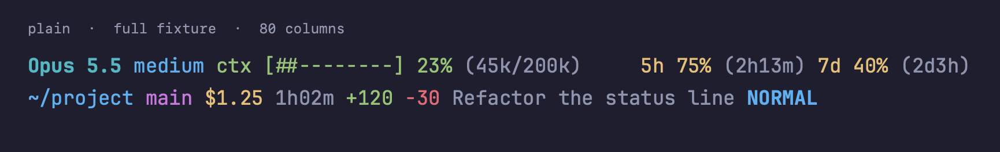
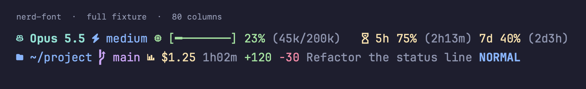

# shiori (栞)

A status line for [Claude Code](https://code.claude.com/docs/en/statusline), written in Nim,
configured with [Starship](https://starship.rs)-style TOML, and shipped as a Nix flake with a
home-manager module. It shows model, effort, context usage, rate limits, cost, directory, Git
branch, session name and Vim mode; `fill` aligns content to the right.

**No subprocess, no network in the render path.** shiori reads stdin JSON, its configuration,
and Git metadata (at most two small files). Missing or malformed input degrades gracefully;
the binary exits 0 and always prints a non-empty line. Diagnostics go to stderr.

The M2 implementation and M3 repository files are delivered. Deployment, Linux execution and
publication checks are tracked in [milestones](docs/milestones.md). The specification is the
[ten accepted ADRs](docs/adr/README.md). Licensed under [MIT](LICENSE).

## Presets

`plain` needs no special font and is also the built-in default:



`nerd-font` uses a [Nerd Font](https://www.nerdfonts.com/) and includes
[Catppuccin Mocha](https://github.com/catppuccin/palette):



These images render the committed `full` snapshots at 80 cells, with a temporary Git checkout
and a fixed clock. Every fixture has a snapshot for each preset.

## Install with Nix

Try it without a clone:

```sh
nix run github:scorsi/shiori -- preview
```

Or build locally:

```sh
nix build
./result/bin/shiori preview --config presets/nerd-font.toml
```

Add the input to your existing home-manager flake:

```nix
inputs.scorsi-shiori = {
  url = "github:scorsi/shiori";
  inputs.nixpkgs.follows = "nixpkgs";
};
```

Then import its module in your home configuration:

```nix
imports = [ inputs.scorsi-shiori.homeModules.shiori ];
programs.shiori = {
  enable = true;
  preset = "nerd-font"; # "plain" by default
  settings = {
    palette = "catppuccin-mocha";
    context.bar_width = 8;
    effort.hide_levels = [ "medium" ];
  };
};
```

The module installs the binary, generates the TOML and merges `statusLine` into Claude Code's
mutable `settings.json` at activation. Other JSON keys are preserved; the file is not owned
as a store symlink. This works with or without `programs.claude-code`.

| `programs.shiori` option | Default | Meaning |
| --- | --- | --- |
| `enable` | `false` | Install and configure shiori. |
| `package` | This flake's package | Binary and its `presets` directory. |
| `preset` | `"plain"` | Enum derived from `presets/*.toml`. |
| `settings` | `{}` | Recursive overrides over the complete preset; arrays are replaced wholesale. |
| `configFile` | `${xdg.configHome}/shiori.toml` | Absolute destination under the home directory; also sets `SHIORI_CONFIG` for the shell and Claude Code command. |
| `claudeCode.enable` | `true` | Install the activation-time `statusLine` merge. |
| `claudeCode.settingsFile` | `${programs.claude-code.configDir}/settings.json` when enabled, otherwise `~/.claude/settings.json` | Mutable file to patch. |

In sekkeizu, keep its existing input and import, select `preset = "nerd-font"` and set
`settings.palette = "catppuccin-mocha"`. Update the pinned `scorsi-shiori` input after publishing
the reviewed commit. No application code belongs in sekkeizu.

## Commands

```sh
shiori < input.json
shiori timings < input.json
shiori preview
shiori preview --fixture narrow --config presets/nerd-font.toml
COLUMNS=40 shiori preview --fixture narrow
shiori --help
shiori --version
```

`preview` embeds the fixtures at compile time, defaults to `full`, and uses a fixed sample
clock. It never reads stdin. Fixtures: `full`, `minimal`, `invalid`, `pre-first-reply`,
`free-plan`, `post-compact`, `detached-head`, `narrow`. Their paths remain sanitized under
`/home/user/`; Git appears only when that path is a real checkout. Snapshot tests supply the
corresponding temporary repositories, including a detached HEAD.

`timings` renders stdin normally and reports microseconds for input, config, each evaluated
segment and total rendering, plus the input version, on stderr. Repeated segments are evaluated
once; unreferenced and disabled segments are not measured. Rendering time includes its segments.

## Configuration reference

Resolution: `$SHIORI_CONFIG`, then `$XDG_CONFIG_HOME/shiori.toml` (or `~/.config/shiori.toml`),
then the built-in `plain` preset. `preview --config PATH` overrides the environment path.
A missing file silently uses defaults. A parse error, unknown key, wrong type, unknown palette
or invalid literal style emits one stderr line and falls back to defaults for the whole file.
Unspecified keys in a valid file retain their defaults.

The binary has no preset-selection key: presets are complete TOML files, selected and merged
by Nix, or passed to `preview --config`. Start from [plain](presets/plain.toml) or
[nerd-font](presets/nerd-font.toml).

```toml
format = """
$model[ $effort]()[ $context]()[ $fill$rate_limits]()
$directory[ $git_branch]()[ $cost]()[ $session_name]()[ $vim_mode]()
"""
palette = "my-theme"

[context]
bar_width = 8
threshold_warn = 70
threshold_critical = 90

[palettes.my-theme]
green = "#a6e3a1"
yellow = "#f9e2af"
red = "#f38ba8"
```

### Top-level keys and grammar

| Key | Meaning |
| --- | --- |
| `format` | Multiline layout; the default above shows all nine data segments on two lines. |
| `palette` | Active palette name; `""` (the plain default) selects built-in colours. |
| `palettes` | Container for named palettes. |
| `palettes.<name>` | Arbitrarily named colour table. |
| `palettes.<name>.<colour>` | Colour name mapped to a built-in colour, `0`–`255` string, or `#rrggbb`; aliases to other palette entries are not supported. |

- `$name` and `${name}` expand a segment at top level, or a variable inside a segment.
- `[text](style)` styles text; groups may nest. A group disappears, including its literal
  punctuation, when all its data variables are empty. `$symbol`, `$style` and `$fill` do not
  keep an otherwise empty group alive. A group with only literal text stays.
- `[ $cost]()` is a conditional leading space with no extra style.
- Newlines start new lines; empty lines are removed. Escape `$`, `[`, `]` and `\` with `\`.
  In TOML double-quoted strings the backslash must itself be escaped.
- The first `$fill` per line pads to `COLUMNS`; later fills on that line are ignored. Unset,
  invalid or nonpositive `COLUMNS` means 80. Overlong lines are clipped on the right, without
  cutting UTF-8 characters or leaving SGR styles open.

### Shared segment keys

Every segment table below accepts these keys (`segment` stands for its table name):

| Key | Meaning |
| --- | --- |
| `segment.format` | Template using the variables below, `$style` and `$symbol`. For `fill`, the rendered template is the repeated padding unit. |
| `segment.symbol` | String available as `$symbol`; shown where the template references it. |
| `segment.style` | Default style, available as `$style`; also styles the padding for `fill`. |
| `segment.disabled` | Boolean, `false` by default; suppresses evaluation and output. |

### Segments and extra keys

All data segments disappear when their relevant input is absent. Zero cost and zero usage
are data, so they remain visible. See the preset files for the complete default templates.

| Table | Variables and behavior |
| --- | --- |
| `model` | `$name`: model display name, falling back to its ID. |
| `effort` | `$level`: effort level. |
| `context` | `$percentage`, `$bar`, `$tokens` (such as `45k/200k`); hidden without `used_percentage`, including before a first reply and after compaction. |
| `rate_limits` | `$five_hour`, `$seven_day`, `$five_hour_reset`, `$seven_day_reset`; reset times such as `2h13m`, or `0m` after expiry. The higher usage chooses the style. |
| `cost` | `$usd` (such as `$1.25`), `$duration` (`1h02m`), `$added`, `$removed`. Each value can be absent independently. |
| `directory` | `$path`: `workspace.current_dir`, falling back to `cwd`; shortens the home prefix on a component boundary. |
| `git_branch` | `$branch`: branch name or seven-character detached SHA. Walks upward for `.git/HEAD`; follows a `gitdir:` file once for worktrees and submodules. Missing or unreadable metadata produces no branch. No dirty, ahead or behind state. |
| `session_name` | `$name`: session name. |
| `vim_mode` | `$mode`: uppercased mode; unknown modes use the generic style. |
| `fill` | Padding; no data variables. Its format and symbol must each fit on one line. ANSI has zero width; a wide padding unit leaves spaces for leftover cells. An empty or zero-width unit uses spaces. |

| Extra key | Plain default | Meaning |
| --- | --- | --- |
| `effort.hide_levels` | `[]` | Exact effort strings to suppress, for example `["medium"]`. |
| `context.bar_width` | `10` | Number of bar units. |
| `context.bar_fill` | `"#"` | Filled unit. |
| `context.bar_empty` | `"-"` | Empty unit. |
| `context.threshold_warn` | `70` | Warn at or above this percentage. |
| `context.threshold_critical` | `90` | Critical at or above this percentage. |
| `context.style_warn` | `"yellow"` | Warning style. |
| `context.style_critical` | `"red"` | Critical style. |
| `rate_limits.threshold_warn` | `70` | Warning threshold for the more used window. |
| `rate_limits.threshold_critical` | `90` | Critical threshold for the more used window. |
| `rate_limits.style_warn` | `"yellow"` | Warning style. |
| `rate_limits.style_critical` | `"red"` | Critical style. |
| `cost.precision` | `2` | Decimal places in `$usd`. |
| `directory.truncation_length` | `3` | Retained path components; nonpositive keeps the full path. |
| `directory.home_symbol` | `"~"` | Replacement for the user's home directory. |
| `directory.truncation_symbol` | `".../"` | Prefix when components are omitted; `nerd-font` uses `"…/"`. |
| `git_branch.truncation_length` | `0` | Maximum Unicode code points; nonpositive disables truncation. |
| `vim_mode.normal_style` | `"bold blue"` | Style for `NORMAL`. |
| `vim_mode.insert_style` | `"bold green"` | Style for `INSERT`. |

### Styles and palettes

Styles are space-separated: `bold`, `dim`, `italic`, `underline`, `inverted`, `none`; colours
`black red green yellow blue magenta cyan white`, `bright-<colour>`, `0`–`255`, or `#rrggbb`.
A bare colour sets the foreground; `bg:<colour>` sets the background. Truecolour is emitted
without downsampling. Palette colours take precedence over built-in colour names, including
in backgrounds and nested groups. An unknown active palette is a configuration error.

The small width table covers East Asian text, combining accents and common emoji sequences,
including joined emoji and flags. Ambiguous-width characters and Nerd Font private glyphs
are treated as one cell; a terminal with different font-width conventions can differ.

## Performance and development

Benchmark on the author's Apple Silicon machine (`aarch64-darwin`, 2026-10-22):
**1.438 ms median**, below the 5 ms budget. `nix run .#bench` measures the release binary with
`plain`, `COLUMNS=80`, ten warmups and 100 runs, including startup and config loading, without
an intermediate shell. The `full` fixture's workspace paths are mapped to a temporary local
repository with a `main` HEAD, as in the snapshots. This avoids macOS automounting the synthetic
`/home/user` path and includes a real Git HEAD read. Temporary files are removed afterwards.
The app exits nonzero if the median is at least 5 ms; timing is not a sandboxed flake check.

```sh
nix develop                     # or direnv allow
nim r tests/tsegments.nim
SHIORI_UPDATE_SNAPSHOTS=1 nim r tests/trender.nim
nix fmt
nix flake check
nix run .#bench
```

Review snapshot diffs before committing. Tests fix time, home and width, and create temporary
repositories under `tests/`. `tests/tdocs.nim` lists every preset key and fails if the reference
above omits it. Shared segment keys and arbitrary palette names are documented once.

Only regenerate dependencies when they change, after approval of the dependency decision:

```sh
nix run .#lock
```

This reuses the dev shell's `nim_lk` OpenSSL wrapper and replaces `lock.json` only after successful
generation and JSON validation. Do not invoke the unwrapped Nim HTTPS tools on macOS.

| Flake output | Contents |
| --- | --- |
| `packages.default`, `packages.shiori` | Release binary, unit tests, snapshots and installed-binary checks; `presets` passthru points at the preset directory. |
| `homeModules.shiori`, `homeModules.default` | home-manager module; `homeManagerModules` is an alias. |
| `overlays.default` | Adds `shiori`. |
| `checks` | Package tests, formatting, and home-manager evaluation with local option stubs plus an activation merge check. |
| `apps.bench`, `apps.lock` | Performance budget and dependency lock generation. |
| `devShells.default` | Nim, wrapped `nim_lk`, hyperfine, jq and nixfmt. |
| `formatter` | nixfmt via nixfmt-tree. |

Outputs are declared for `aarch64-darwin`, `x86_64-darwin`, `x86_64-linux` and `aarch64-linux`.
The recorded execution checks are on `aarch64-darwin`; Linux still needs a Linux builder.

## Layout

```
src/shiori/          input, config, format, segments, style, render, cli
presets/            complete plain and nerd-font configurations
tests/fixtures/     sanitized Claude Code stdin documents
tests/snapshots/    expected output per fixture and preset
nix/                package, home-manager module and evaluation test
docs/adr/           accepted decisions; docs/milestones.md tracks delivery
```

## Name

栞 is a bookmark: the strip that tells you where you are in a book, as the status line tells you
where you are in a session. The project was first called hikouki (飛行機, aeroplane, a nod to
Starship), then keiki (計器, cockpit gauges), renamed because it read too close to kekkai.
